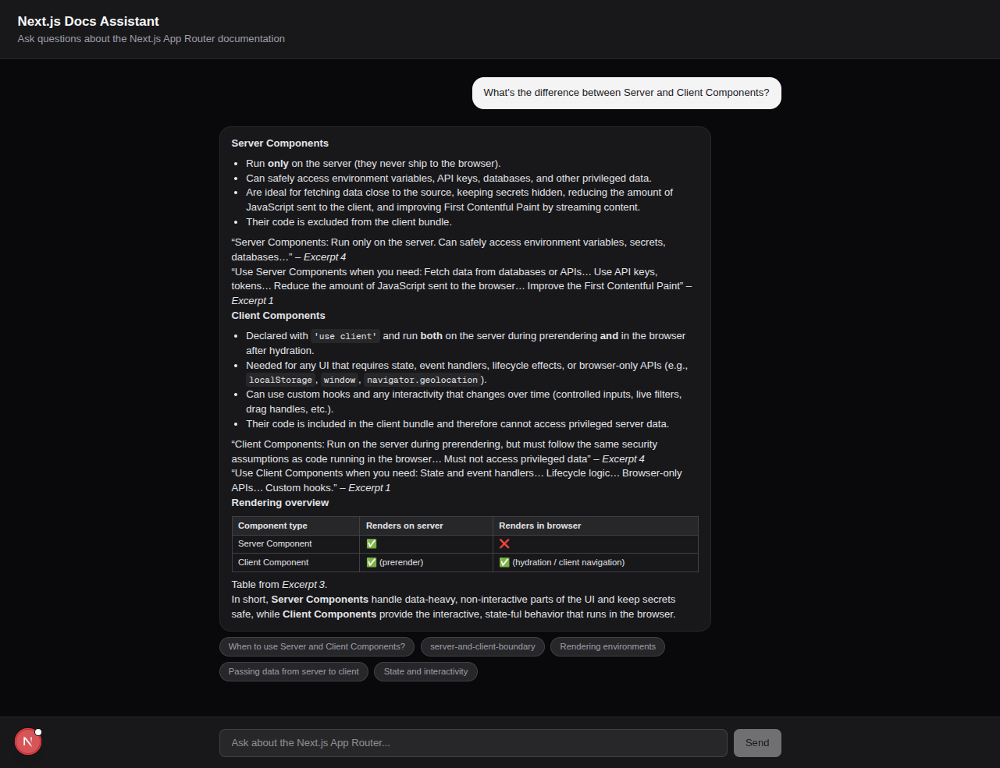
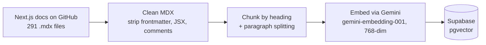
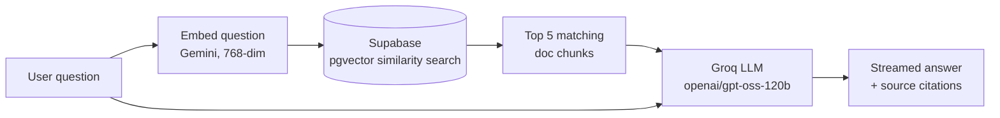

# Next.js Docs Assistant

A RAG-powered support chatbot that answers questions about the [Next.js App Router documentation](https://nextjs.org/docs/app) — grounded in real docs content, with source citations, not hallucinated from memory.

**Live demo:** _add your Vercel URL here after deploying_



## Why this exists

Most "chat with your docs" demos are thin wrappers around an LLM call. This project is built to show the actual mechanics of retrieval-augmented generation: how documents get chunked, how retrieval quality is affected by chunk size and embedding choice, and how to keep an LLM from making things up when it doesn't know the answer.

## How it works

**Ingestion (one-time setup)**



**Answering a question**



The system prompt instructs the model to answer **only** from the retrieved excerpts and explicitly say so when it doesn't have enough information — instead of falling back on its own training data. This is what keeps answers grounded and verifiable: every response comes with clickable links back to the exact docs sections used.

## Tech stack

| Layer | Choice | Why |
|---|---|---|
| Frontend / API | Next.js 16 (App Router), TypeScript | Server + client in one deployable unit, streaming-friendly |
| Styling | Tailwind CSS | Fast iteration, built-in dark mode |
| LLM inference | [Groq](https://groq.com) (`openai/gpt-oss-120b`) | Free tier, very low latency |
| Embeddings | [Google Gemini](https://ai.google.dev) (`gemini-embedding-001`, 768-dim) | Free tier, Matryoshka truncation keeps vectors small enough for `pgvector` to index |
| Vector database | [Supabase](https://supabase.com) (Postgres + `pgvector`) | Free tier, SQL-native, no separate vector DB to manage |
| Hosting | [Vercel](https://vercel.com) | Free tier, zero-config Next.js deploys |

Every piece of this runs on a free tier with no credit card required.

## Design decisions worth knowing about

- **Chunking**: docs are split along heading boundaries first, then further split by paragraph if a section is still too long (~1200 chars max). This keeps each retrieved chunk focused on one topic rather than an arbitrary fixed-size slice that might cut a code example in half.
- **Embedding dimensions**: Gemini's `gemini-embedding-001` outputs 3072-dim vectors by default, but `pgvector`'s indexes only support up to 2000 dimensions. The embedding calls explicitly request 768 dimensions (Matryoshka representation learning lets you truncate without a proportional quality loss) — smaller, faster, and indexable.
- **Streaming**: the `/api/chat` route uses Server-Sent Events, sending retrieved sources first and then streaming the answer token-by-token, so the UI shows sources immediately while the answer is still generating.
- **Grounding over fluency**: the system prompt explicitly trades off "always give a confident answer" for "say you don't know when the docs don't cover it." Tested against off-topic questions — the bot correctly declines rather than guessing.
- **Resumable ingestion**: `scripts/ingest.ts` checks how many chunks are already in Supabase before starting and picks up from there. Free-tier embedding APIs rate-limit hard under sustained load, so being safely re-runnable after a failure was a real, not hypothetical, requirement during development.

## Project structure

```
nextjs-docs-bot/
├── app/
│   ├── page.tsx              # renders the chat UI
│   └── api/chat/route.ts     # POST endpoint: retrieval + streamed LLM answer
├── components/
│   ├── ChatWindow.tsx        # message list, input, streaming, markdown rendering
│   └── SourcesPanel.tsx      # clickable source citation chips
├── lib/
│   ├── chunk.ts              # MDX cleaning + heading/paragraph chunking
│   ├── gemini.ts             # batch embedding calls with retry/backoff
│   ├── groq.ts               # LLM prompt + streaming completion
│   ├── retrieve.ts           # embed question → similarity search in Supabase
│   └── supabase.ts           # Supabase client (service role, server-side only)
├── scripts/
│   ├── ingest.ts             # one-time: fetch docs → chunk → embed → store
│   └── test-connection.ts    # verifies Supabase schema is set up correctly
└── supabase/
    └── schema.sql            # pgvector table + similarity search function
```

## Running it locally

1. Clone the repo and install dependencies:
   ```bash
   npm install
   ```

2. Copy the env template and fill in your own free-tier API keys:
   ```bash
   cp .env.local.example .env.local
   ```
   You'll need:
   - A [Supabase](https://supabase.com) project URL + service role key
   - A [Google AI Studio](https://aistudio.google.com) API key (for embeddings)
   - A [Groq](https://console.groq.com) API key (for the LLM)

3. Set up the database — run `supabase/schema.sql` in your Supabase project's SQL Editor.

4. Ingest the docs (one-time, takes a while on a free tier due to rate limits):
   ```bash
   npx tsx scripts/ingest.ts
   ```

5. Run the dev server:
   ```bash
   npm run dev
   ```
   Open [http://localhost:3000](http://localhost:3000).

## Deployment

Deployed on [Vercel](https://vercel.com)'s free tier — connect the GitHub repo, add the same environment variables from `.env.local` in the Vercel project settings, and deploy. No server or infrastructure to manage.
